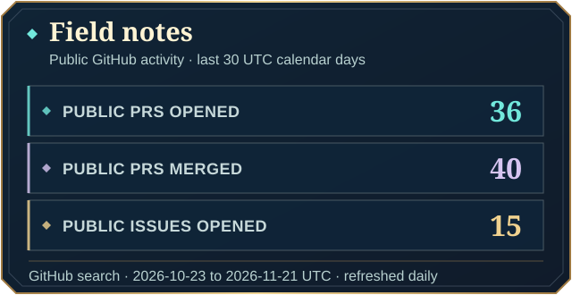

**AI Lead & AI Enablement Architect**

I build production AI systems and practical developer tools.

[Connect on LinkedIn](https://www.linkedin.com/in/david-castro-rojo/) · Spain · Remote

## Quest log

Turn local repository evidence into focused agent skills. [Try the scanner](https://github.com/Dcastroro/repo-craft#context-debt-scanner)

Plan affected projects from Git changes and their dependencies. [Run the demo](https://github.com/Dcastroro/change-scope#try-it) · [CI guide](https://github.com/Dcastroro/change-scope/blob/main/docs/ci.md)

Check service readiness with bounded probes and reports that omit URLs, headers and response bodies. [Try the local demo](https://github.com/Dcastroro/probe-harbor#try-the-local-demo)

Explore real GitHub repository activity, open work and recent commits. [Open the live demo](https://dcastroro.github.io/repository-pulse/)

Cross-browser checks for user flows, keyboard interaction and API recovery, with reproducible local tests and CI. [Try the live demo](https://dcastroro.github.io/browser-quality-lab/)

**[MCP Recovery Lab](https://github.com/Dcastroro/mcp-recovery-lab#try-it)** — run a scripted agent against a simulated MCP server and see how it handles rate limits, stale reads, denied access and malformed responses.

[Explore all repositories](https://github.com/Dcastroro?tab=repositories)

## Developer toolbox

**Agent workflows**

- [SDD Starter](https://github.com/Dcastroro/sdd-starter#try-it) — start with a spec, link it to implementation tasks, and check the result in CI.
- [Claude Repo Skills](https://github.com/Dcastroro/claude-repo-skills#usage) — generate Claude Code skills from a repository’s structure and documentation.

**CI, APIs and test data**

- [Env Contract Check](https://github.com/Dcastroro/env-contract-check#try-it-in-a-minute) — catch missing environment variables before startup.
- [Task Relay](https://github.com/Dcastroro/task-relay#define-your-workflow) — run dependent tasks with bounded parallelism and timeouts.
- [Webhook Ledger](https://github.com/Dcastroro/webhook-ledger#try-it) — coordinate webhook deduplication and retries with SQLite.
- [API Drift Guard](https://github.com/Dcastroro/api-drift-guard#compare-your-contracts) — compare OpenAPI contracts locally and flag breaking changes in CI.
- [Fixture Foundry](https://github.com/Dcastroro/fixture-foundry#quick-start) — generate reproducible synthetic data as JSONL or CSV.

## Field notes

Public pull requests and issues from the last 30 UTC days, refreshed daily from GitHub search. [Explore repository activity](https://dcastroro.github.io/repository-pulse/).

 Playwright checks the panel in Chromium at mobile and desktop widths. Follow the badge for actual run details.

## Co-op contributions

### Merged upstream

- **Agent tooling:** [acpx displays hidden child directories as explicit relative paths in session banners](https://github.com/openclaw/acpx/pull/1035). Lobster now [handles CRLF table cells](https://github.com/openclaw/lobster/pull/224) and [expands repeated date tokens](https://github.com/openclaw/lobster/pull/225). Both Lobster fixes were incorporated into [upstream PR #223](https://github.com/openclaw/lobster/pull/223) with contributor credit.
- **CLI:** [ClawHub returns a nonzero exit status when `inspect` cannot resolve an explicitly requested tag](https://github.com/openclaw/clawhub/pull/4835).
- **Localization:** [Babel decodes JavaScript vertical-tab escapes during message extraction](https://github.com/python-babel/babel/pull/1409).
- **MCP:** [mcp-proxy now includes `uv` and `uvx` in its container](https://github.com/sparfenyuk/mcp-proxy/pull/268). FastMCP gained [Windows-safe HTTP/HTTPS tests](https://github.com/punkpeye/fastmcp/pull/436) and [retries for transient DiskStore write failures](https://github.com/punkpeye/fastmcp/pull/438).
- **Storage:** [rclone applies metadata options to Internet Archive server-side copies](https://github.com/rclone/rclone/pull/10159). [rclone keeps Oracle Object Storage range reads from changing shared metadata](https://github.com/rclone/rclone/pull/10297). [fsspec flushes cached ZIP writes on explicit close](https://github.com/fsspec/filesystem_spec/pull/2312).
- **Automation:** [Apprise renews persistent files read with the default key](https://github.com/caronc/apprise/pull/1814). [claude-session-tidy adds session-title filtering](https://github.com/nrzz/claude-session-tidy/pull/5).

### Review contributions

- [claude-session-tidy #7](https://github.com/nrzz/claude-session-tidy/pull/7#discussion_r4307564195) — identified and validated a date-dependent CLI test failure. The PR author applied the fix, which shipped in [v1.3.0](https://github.com/nrzz/claude-session-tidy/releases/tag/v1.3.0).

### In review

- [MCP Atlassian #1764](https://github.com/sooperset/mcp-atlassian/pull/1764) — return stored Jira comment visibility in read and write responses. [GitHub checks passed](https://github.com/sooperset/mcp-atlassian/pull/1764/checks). Live Jira validation is pending.
- [Swift #193](https://github.com/ncw/swift/issues/193) — reported an incorrect read position after seeking to EOF. An [upstream fix is open](https://github.com/ncw/swift/pull/194).

## Trophy room

Custom RPG ranks based on GitHub activity, refreshed automatically. [Official GitHub achievements](https://github.com/Dcastroro?tab=achievements) are separate.

---

**Working with** Python · JavaScript/TypeScript · AWS Bedrock · MCP · GitHub Actions
