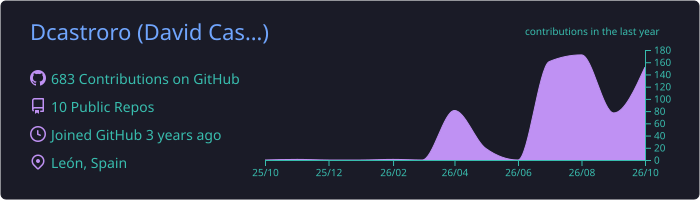

 

**AI Enablement & Growth Infrastructure Lead**

I design and ship production AI systems that connect engineering,
quality and measurable business outcomes.

## Selected Developer Tools

Practical tools for repeatable setup, repository context and automation.

| Project | What it does |
| --- | --- |
| [Webhook Ledger](https://github.com/Dcastroro/webhook-ledger) | Coordinates local event receipts with SQLite deduplication, atomic worker leases and retries, without storing event payloads or raw IDs. |
| [API Drift Guard](https://github.com/Dcastroro/api-drift-guard) | Compares local OpenAPI contracts with conservative CI gates and reports that omit input names and values. |
| [Task Relay](https://github.com/Dcastroro/task-relay) | Runs development task graphs with bounded parallelism, dependency checks, timeouts and JSON reports. |
| [Env Contract Check](https://github.com/Dcastroro/env-contract-check) | Validates environment files against an example contract, with value-free diagnostics and CI-friendly JSON. |
| [Repo Craft](https://github.com/Dcastroro/repo-craft) | Maps repository context and crafts evidence-backed skills for coding agents. |
| [Claude Repo Skills](https://github.com/Dcastroro/claude-repo-skills) | Generates repository-aware Claude Code skills from existing project structure and documentation. |

Task Relay can use Env Contract Check as a prerequisite: validate configuration before starting tests or builds. [See the integration example](https://github.com/Dcastroro/task-relay/blob/main/docs/integrations.md).

API Drift Guard adds a local API-contract check to that workflow, with no service credentials or remote reference fetching. [See the contract gate example](https://github.com/Dcastroro/api-drift-guard/blob/main/docs/automation.md).

---

Selected work is intentionally described at a high level. Internal architecture, controls and operational details are not disclosed.

---

## 🏆 Achievement Realm

Live tiers generated from GitHub activity · refreshed automatically every 30 minutes

---

## 📜 Explorer's Ledger

---

## 🛠️ Technical Arsenal

---

