**AI Lead & AI Enablement Architect**

I build production AI systems and practical developer tools.

[Connect on LinkedIn](https://www.linkedin.com/in/david-castro-rojo/) · Spain · Remote

## Quest log

Turn local repository evidence into focused agent skills. [Try the scanner](https://github.com/Dcastroro/repo-craft#context-debt-scanner)

Plan affected projects from Git changes and their dependencies. [Run the demo](https://github.com/Dcastroro/change-scope#try-it) · [CI guide](https://github.com/Dcastroro/change-scope/blob/main/docs/ci.md)

Check service readiness with bounded probes and reports that omit URLs, headers and response bodies. [Try the local demo](https://github.com/Dcastroro/probe-harbor#try-the-local-demo)

[Explore all repositories](https://github.com/Dcastroro?tab=repositories)

## Co-op contributions

- **FastMCP:** [Windows-safe HTTP/HTTPS tests](https://github.com/punkpeye/fastmcp/pull/436) and [resilient DiskStore writes](https://github.com/punkpeye/fastmcp/pull/438).
- **Apprise:** [persistent-file renewal](https://github.com/caronc/apprise/pull/1814), with cache-handling refinements by the maintainer.
- **claude-session-tidy:** [session-title filtering and Windows checks](https://github.com/nrzz/claude-session-tidy/pull/5).

- **fsspec:** [flush cached ZIP writes on explicit filesystem close](https://github.com/fsspec/filesystem_spec/pull/2312).

## Trophy room

Custom RPG ranks based on GitHub activity, refreshed automatically. [Official GitHub achievements](https://github.com/Dcastroro?tab=achievements) are separate.

---

**Working with** Python · JavaScript/TypeScript · AWS Bedrock · MCP · GitHub Actions
